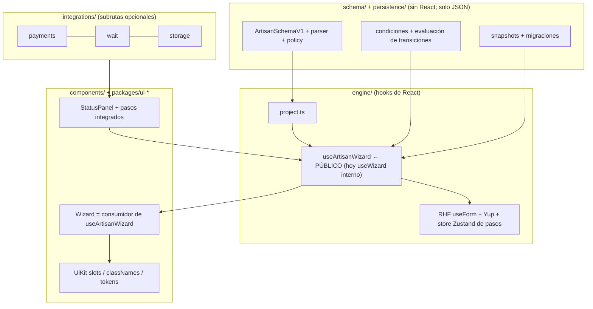
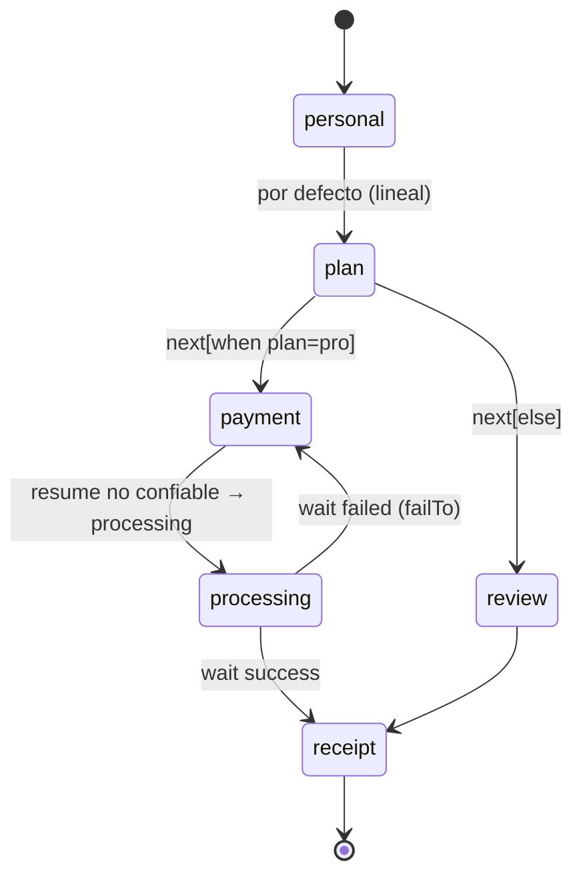

# ArtisanForm: plan de evolución (headless · UI lista · workflow)

> Versión en español de [`docs/planning/artisanform-evolution.md`](../../planning/artisanform-evolution.md). Si difieren, manda el inglés. Sin cambios de código, sin commits, sin instalaciones.
>
> **Base de la auditoría.** Rama `fix/AF78-payment-resume-untrusted` (con `develop` mergeado, 3 commits por delante de `origin/develop`). Verificado leyendo código con tres auditorías de solo lectura en paralelo. Comandos realmente ejecutados: `bun test` → exit 0, 229 pass / 0 fail / 30 archivos; `bun run typecheck` → exit 0; `bun run lint` → exit 0 (3 warnings). NO ejecutados: build, e2e, `lint:react`, `check:*`. Los tamaños salen de un `dist/` existente, no son benchmarks. Las afirmaciones sobre competidores (§3) marcadas con ✔ se verificaron con búsqueda web el 2026-11-10 (fuentes allí); las demás vienen de conocimiento previo.

---

## 1. Resumen ejecutivo

**Diagnóstico.** ArtisanForm ya tiene un buen *contrato* (esquema v1 serializable, parser con allowlist, normalizador, snapshots) y un buen *comportamiento de wizard* (`useWizard`), pero no se ofrecen como capas. El motor sigue corriendo sobre la forma legacy 0.2.0 (`projectToRuntime` proyecta v1 de vuelta), la navegación es por índice y estrictamente lineal, no hay API headless pública y los valores no tienen tipo (`Record<string, unknown>`). Las piezas de los tres niveles de adopción existen; las costuras entre ellos son internas.

**Dirección.**
1. **Estabilizar** (barato, desbloquea todo): tests de caracterización en costuras sin cobertura, corregir defectos conocidos, eliminar la colisión de nombre `useArtisanForm`.
2. **Headless = promover `useWizard`**, no un motor independiente de React. RHF es una librería de hooks de React; un núcleo sin React no tendría hoy un segundo consumidor.
3. **Valores tipados + navegación por id**, aditivo sobre v1 (sin `schemaVersion: 2`).
4. **Workflow = transiciones `next` opcionales en los pasos** + pila de historial, reutilizando `pending`/`WaitStrategy`/`PaymentStep`. Sin BPMN ni motor nuevo.
5. **Migraciones de snapshot + storage conectable** al final; dependen de ids estables y transiciones.

**Un solo paquete.** Agregar *entradas por subruta* (`headless`, `schema`), no paquetes nuevos.

---

## 2. Estado actual (auditoría)

Leyenda: ✅ estable · 🔧 implementado, requiere mejoras · ◐ parcial · 📄 documentado, no implementado · ✗ ausente.

### 2.1 Contrato / esquema (`src/schema/**`)
| Elemento | Estado | Evidencia |
|---|---|---|
| Tipos v1: 28 campos nativos + `x-*`, 7 pasos + `x-*` | ✅ | `contract/specs.ts` (`FIELD_KEYS`, `STEP_KEYS`, completitud en compilación vía `specsAreComplete`) |
| Condiciones (`eq…`, `all/any/not`), tope de profundidad 32 | ✅ | `contract/conditions.ts` `evaluateCondition` |
| Parser + `SchemaPolicy` allowlist (hooks, wait, renderers, acciones, providers; URLs inseguras; ids duplicados; referencias rotas) | ✅ | `parser.ts` `parseArtisanSchema` |
| Normalizador + adaptador legacy | ✅ | `normalize.ts`, `legacy/adapter.ts` |
| Condiciones solo leen nombres planos y solo gobiernan visibilidad | 🔧 | `contract/conditions.ts` |
| `optionsSource` solo en combobox/multiselect | ◐ | `docs/schema-v1.md` §9 |
| `variant` y `layout:'horizontal'` no interpretados por la UI por defecto | ◐ | `FieldUIConfig.variant`; el CSS no tiene reglas `data-layout` |
| Condiciones dentro de filas `array`; arrays anidados | 📄 | schema-v1.md §14 |
| **Ramificación / transiciones / `next` / `goTo`** | ✗ | no existe esa clave en `src/schema` |
| **Inferencia de tipos de valores** (`InferValues`); `defineForm` es identidad | ✗ | `contract/define.ts`; `FormValues = Record<string, unknown>` |

### 2.2 Motor (`src/engine/**`, `components/ArtisanForm/**`)
| Elemento | Estado | Evidencia |
|---|---|---|
| Un único `useForm` de RHF + un esquema Yup con `when()` | ✅ | `form/useArtisanForm.ts`, `buildSchema.ts` |
| Zustand solo guarda `step, processStep, isFinalStep, submitState, submitError`, un store por instancia | ✅ | `store/useArtisanStore.ts` |
| Salto de pasos por visibilidad, `trigger` por paso, `beforeNext` asíncrono con token | ✅ | `useWizard.ts` `advance`, `engine/conditions.ts` |
| `useWizard` = todo el comportamiento; `Wizard.tsx` = solo markup | ◐ | `useWizard.ts` (328 líneas, `'use no memo'`). Interno, **no exportado** |
| El motor consume la forma legacy; proyección v1→legacy | 🔧 | `engine/project.ts`; `RuntimeProjection.key = JSON.stringify(schema)` reinicia el form |
| API pública por índice (`step`, `onStepChange`, `goTo`) mientras los snapshots usan ids | 🔧 | props de `ArtisanForm`, `resolveStep` |
| `useArtisanStore` expone internos como API pública | 🔧 | `src/index.ts` |
| **API headless pública** | 📄/✗ | comentario de useWizard, README "Pending" |
| Validación atada a Yup (`FieldDefinition.rules`) | 🔧 | `fields/registry.tsx` |
| RHF/Yup/Zustand son peers obligatorios incluso para quien solo usa el esquema | 🔧 | `package.json` |
| **Colisión de nombre**: `docs/ui.md` promete un `useArtisanForm` público; ya existe uno interno que devuelve `{methods, validators}` | 🔧 | `engine/form/useArtisanForm.ts` |

### 2.3 UI lista (`components/ui/**`, `packages/ui-*`, CSS)
| Elemento | Estado | Evidencia |
|---|---|---|
| 71 slots `af-*` + `classNames` + `unstyled` + tokens; precedencia default<kit<props | ✅ | `ui/UiContext.ts`, `ui/kit.ts` |
| Reemplazables: Stepper, Controls, StepHeader, FormError, FieldWrapper, 20 inputs de valor simple vía `InputBridge` | ✅ | `ui/types.ts`, `InputBridge.tsx` |
| Kits bootstrap, tailwind, mui, scss con conformance; shadcn es copy-paste probado con stubs | ✅/◐ | `ui/__tests__/conformance.tsx` |
| **No reemplazables vía `components`**: `array`, `file/image`, `dynamicSelect`, `daterange`, campos de contenido, `StatusPanel` (pago/espera/resultado), cascarón del form, orden de pasos | 🔧 | `fields/registry.tsx`, `steps/StatusPanel.tsx` |
| Stepper solo display (sin visitado/válido ni salto) | 🔧 | `Stepper.tsx` |
| `af-error` fijo evita `cx`/`unstyled` en el fallback de paso desconocido | 🔧 | `steps/registry.tsx` L448 |
| Sin tokens dark, sin `prefers-reduced-motion`, foco solo en 3 clases | ✗ | `styles/artisanform.css` |
| Props de campos/pasos custom sin tipo (casts como `step.wait as WaitStrategy`) | 🔧 | `steps/registry.tsx` |

### 2.4 Capacidades de workflow (`steps/`, `integrations/`)
| Elemento | Estado | Evidencia |
|---|---|---|
| Paso `pending` + `WaitStrategy` (polling/sse/websocket/callback), abort al desmontar, reintento, `failTo` | ✅ | `PendingStep`, `integrations/wait` |
| Paso de pago: elección de plugin, idempotency key por intento, redirect + embebido, reintento, `resume` | ✅ | `steps/PaymentStep.tsx` |
| AF78: `resume` de provider ya no puede devolver `succeeded` desde la URL | 🔧 | `payments/resume.ts`; solo por plugin. **El `PaymentStep` del núcleo confía en cualquier `resume`; nada exige un `pending` tras `processing`** |
| `signal` de pago nunca se aborta | 🔧 | `PaymentStep.tsx` |
| **Bug sospechado (no verificado en runtime):** `failTo` es un id en v1 pero se proyecta a índice de la lista completa (`project.ts:225`) y `goTo` indexa pasos visibles → mal ruteo si un paso previo está oculto | 🔧 | reproducir en Fase 0 |
| Paso genérico de "acción" asíncrona; cancelar en pending | ✗ | solo `beforeNext`, `onSubmit`, `optionsSource` |
| Storage: `StorageAdapter`, presigned/cloudinary/mock, abort | ✅ | `integrations/storage` |

### 2.5 Persistencia (`src/persistence/**`, `engine/draft.ts`)
| Elemento | Estado | Evidencia |
|---|---|---|
| `ArtisanSnapshotV1`, solo JSON, secretos removidos | ✅ | `persistence/snapshots.ts`, `draft.ts` |
| Detección de conflictos + `onSnapshotConflict`; upgrade de drafts legacy | ✅ | `checkSnapshot`, `upgradeLegacyDraft` |
| Solo localStorage; escritura en cada cambio sin debounce | 🔧 | efecto de guardado en `useWizard` |
| Helpers de IO no exportados | ◐ | `persistence/index.ts` |
| **Migraciones** | ✗/📄 | ninguna; versión mayor = `unsupported` |

### 2.6 Calidad / distribución (medido)
- 30 archivos de tests (229), 8 specs Playwright (22 tests, axe en Chromium). CI amplio (lint, lint:react, typecheck, build, check:*, kits, storybook, tests en Node 22/24, e2e con compiler on/off, Firefox/WebKit, consumidores React 18/19).
- **Sin tests unitarios dedicados** (cobertura NO medida; puede haber cobertura indirecta): `engine/store`, `engine/draft`, `engine/project.ts`, `engine/form/*`, `fields/registry.tsx`, `steps/{registry,PaymentStep,StatusPanel}`, storage presigned/xhr/mock, paquetes de kits.
- 3 warnings de lint: parámetros sin uso `useWizard.ts:66,72`; `biome-ignore` sin efecto `StatusPanel.tsx:23`.
- Aislamiento de capas: la regla Biome y `isolation.test.ts` solo bloquean paquetes de terceros; **nada impide que `schema/` o `persistence/` importen `engine/` o `components/` por ruta relativa**, y el regex no detecta `import('react')`.
- Paquete: solo ESM, una entrada `index` que además importa CSS como side effect, 4 subrutas de pago opcionales. Medido (`dist/` existente): `index.js` 154,142 B / **45,443 B gzip**; `style.css` 12,462 B / 2,919 B gzip.
- Deriva documental: AGENTS.md omite `apps/docs`; la nota headless de `docs/ui.md` colisiona con el nombre interno; CHANGELOG muestra `0.3.0-beta.0` como Unreleased mientras `docs/releasing.md` dice que salió; no hay tags de git.

**Ya existe, no replanificar:** contrato/parser/policy/normalizador, snapshot v1 + conflictos, registries de campos/pasos, sistema de kits, estrategias de espera, plugins de pago + resume por redirect, adaptadores de storage, `beforeNext` asíncrono, `resolveStep` por id, pipelines de CI/release.

---

## 3. Análisis competitivo (✔ = verificado con búsqueda web el 2026-11-10; sin marca = conocimiento previo)

| | Idea central | Fuerte en | Lo que el desarrollador sigue haciendo |
|---|---|---|---|
| **JSON Forms** | JSON Schema + UI Schema, renderers, AJV | ✔ Soporte React, Angular y Vue; ✔ layout `Categorization` con variante `stepper` (soporte por set de renderers sin confirmar) | El flujo es un layout, sin transiciones/workflow; pagos, esperas y drafts son a mano |
| **Uniforms** | ✔ *Bridges* de esquema (JSON Schema, Zod, GraphQL, SimpleSchema) + ✔ temas (AntD, Bootstrap, MUI, Semantic UI, HTML plano) + `AutoForm` | Traer tu propio esquema; muchos temas | Sin wizard/workflow; persistencia, pasos async, pagos a mano |
| **SurveyJS** | Modelo JSON + runtime propio, páginas, expresiones | ✔ Lógica condicional, muchos tipos de pregunta; ✔ Form Library es MIT, ✔ Survey Creator (builder) requiere licencia de pago por desarrollador | Runtime/UI propio (menos componible con RHF); pagos/espera/reanudación sin confirmar en ningún sentido |
| RHF / TanStack Form | Estado + validación | Headless de primer nivel | Todo lo de arriba; **complementarios, construimos sobre RHF** |

Fuentes: [JSON Forms docs (mirror)](https://www.mintlify.com/eclipsesource/jsonforms/concepts/ui-schema), [JSON Forms core README](https://cdn.jsdelivr.net/npm/@jsonforms/core@3.7.0/README.md), [Uniforms en GitHub](https://www.github.com/vazco/uniforms), [licencias SurveyJS](https://surveyjs.io/Licenses). La mayoría de los resultados de JSON Forms eran mirrors de terceros; confirmar en jsonforms.io el soporte de stepper por set de renderers antes de citarlo. Estas búsquedas **no** prueban que los tres competidores carezcan de pagos/espera/reanudación; externamente decir "no son funciones centrales".

**Diferenciación defendible:**
1. **Wizard + pagos + esperas + reanudación de borrador en un contrato serializable.**
2. **Esquemas remotos seguros**: parser con allowlist; hooks/acciones/renderers son ids resueltos localmente, nunca código (implementado).
3. **Mismo esquema, tres profundidades** sobre RHF: hook headless ↔ UI con kits ↔ workflow, sin runtime propietario (por construir).
4. Snapshots versionados con manejo de conflictos (implementado; faltan migraciones).

**No copiar:** builder visual, lenguaje de expresiones, muchos tipos de pregunta, renderers multi-framework.

---

## 4. Arquitectura objetivo



Reglas: el esquema describe, el motor ejecuta, el renderer presenta. **`Wizard.tsx` debe pasar a ser un consumidor del hook público** (usarlo internamente es la prueba de aceptación de la API headless). Los niveles 1/2/3 comparten un hook y un contrato; el nivel 3 es más de lo mismo en el esquema (`next`, `pending`, `payment`).

### Modelo de workflow (aditivo a v1)



---

## 5. Diseño de APIs (existente vs propuesto)

### 5.1 Existente (no reimplementar)
```ts
// src/schema/contract/define.ts (EXISTENTE)
export const defineForm = (s: ArtisanSchemaV1): ArtisanSchemaV1 => s;
// src/engine/form/types.ts (EXISTENTE)
type FormValues = Record<string, unknown>;
// Props de ArtisanForm (EXISTENTE): step?: number; onStepChange?(i: number)
```

### 5.2 Propuesto: esquema tipado → valores tipados (aditivo)
```ts
// PROPUESTO — const generic, compatible hacia atrás (S por defecto = ArtisanSchemaV1)
export function defineForm<const S extends ArtisanSchemaV1>(s: S): S;
export type InferValues<S extends ArtisanSchemaV1> = /* field.type → tipo de valor;
  text|email|… → string; number|range|rating → number; checkbox|switch → boolean;
  multiselect → string[]; daterange → {start,end}; array → InferValues<item>[];
  x-* → unknown salvo que el registry lo aumente; campos de contenido excluidos */;
```
Riesgo: costo de tipos en esquemas grandes; medir el tiempo de `tsc` en los fixtures del playground antes de publicar.

### 5.3 Propuesto: hook headless (promover `useWizard`)
```ts
// PROPUESTO — exportado desde 'artisanform' y 'artisanform/headless' (sin import de CSS)
export function useArtisanWizard<S extends ArtisanSchemaV1>(opts: {
  schema: S | unknown;
  extensions?: ArtisanExtensions;
  fields?: FieldRegistry; stepTypes?: StepRegistry;
  initialValues?: Partial<InferValues<S>>;
  persistKey?: string; storage?: Storage;           // conectable (Fase 5)
  onSubmit?(v: InferValues<S>): void | Promise<unknown>;
}): ArtisanWizard<S>;

interface ArtisanWizard<S> {
  form: UseFormReturn<InferValues<S>>;               // salida a RHF (documentada, estable)
  steps: ReadonlyArray<{ id: string; title?: string; status: 'done'|'current'|'upcoming'; visited: boolean; valid?: boolean }>;
  current: { id: string; index: number; kind: string; fields: VisibleField[] };
  next(): Promise<boolean>;                          // valida, corre beforeNext, sigue transiciones
  back(): void;
  goToStep(id: string): Promise<boolean>;            // por id; la API por índice se mantiene
  submit(): Promise<void>;
  submitState: 'idle'|'submitting'|'success'|'error'; submitError?: unknown;
  Provider: React.FC<{children: ReactNode}>;
  bindField(name: string): FieldBinding;             // = useArtisanField, ahora público
}
```
Decisión: exponer `form` (RHF) directamente en vez de envolver cada método — no reinventar RHF. Renombrar el `useArtisanForm` interno a `useFormBinding` (decisión 1).

### 5.4 Propuesto: transiciones (opcionales, aditivas)
```ts
// PROPUESTO — en cualquier StepV1; ausente ⇒ comportamiento lineal actual
interface StepBaseV1 { /* existente… */ next?: ReadonlyArray<{ when?: ConditionV1; to: string /* id de paso */ }>; }
```
```ts
// PROPUESTO — control por paso (decisión 4)
interface StepBaseV1 {
  loop?: { max: number };                 // cuántas veces ESTE paso puede reingresarse por una arista hacia atrás; ausente ⇒ sin reingreso por transición
  revisit?: 'allow' | 'deny';             // tras confirmar el paso (advance exitoso): ¿Volver/goToStep pueden regresar a él? por defecto 'allow'
}
```
Ejemplo: `payment` → `revisit: 'deny'` una vez pagado; `review` → `loop: { max: 3 }` para editar y re-revisar. Los pasos `revisit:'deny'` los salta Volver y los rechaza `goToStep` (requiere el conjunto de completados en el historial). Ambos son mi lectura de la decisión 4; ajustar si querías otra cosa.

Semántica: se evalúan en orden, gana la primera coincidencia, la última entrada sin `when` es el default; sin `next` ⇒ siguiente paso visible. Parser: destino desconocido (`unknown-step-reference`, código existente), pasos inalcanzables (warning), **chequeo estático de ciclos**: una arista hacia atrás se rechaza salvo que su paso destino declare `loop: { max: n }`. En runtime: **pila de historial** de ids visitados (Volver saca del historial en vez de `index-1`, que es incorrecto con ramas); guarda `maxVisits` como defensa en profundidad.

### 5.5 Propuesto: resiliencia async (reusar `wait`)
```ts
// PROPUESTO — extiende el uso de WaitStrategy, sin tipo de paso nuevo en la primera pasada
wait: { strategy: 'polling', ..., retry?: { max: number; backoffMs: number }, timeoutMs?: number }
// paso pending: control Cancelar opcional → failTo / back
```

### 5.6 Propuesto: migraciones de snapshot
```ts
// PROPUESTO — puras, en persistence/ (sin React), registradas por el consumidor
type SnapshotMigration = (s: ArtisanSnapshotV1) => ArtisanSnapshotV1;
migrations?: Record<string /* fromRevision */, SnapshotMigration>;   // cadena hasta igualar formRevision
```
`snapshotVersion` sigue en 1; se agrega `history?: string[]` opcional. Sin `schemaVersion: 2`: todo son campos opcionales; solo se subiría la versión si cambia una forma *requerida*.

---

## 6. Plan de migración (sin romper)

| Cambio | Estrategia de compatibilidad |
|---|---|
| `defineForm` genérico | genérico por defecto = tipo actual; las llamadas existentes compilan igual |
| `useArtisanWizard` | export nuevo; `useWizard` interno queda hasta migrar `Wizard.tsx`, luego se elimina |
| Renombrar `useArtisanForm` interno | solo interno; sin ruptura pública |
| `goToStep(id)` + `onStepChange(id)` | aditivo: se mantienen `step`/`onStepChange(index)`; nuevos `stepId`/`onStepIdChange`; deprecación solo en docs |
| Transiciones `next` | campo opcional; el parser no falla si falta |
| `history` en snapshot | opcional; los snapshots viejos cargan, el historial se deriva de `currentStepId` |
| Guarda de pago en el núcleo (aplicar `fromReturnUrl` a todo `resume`) | **aceptado** (decisión 6): cambio de comportamiento para plugins custom → CHANGELOG "Security: behavior change", como AF78 |
| Fuga de `useArtisanStore` | se deja como está, documentada como interna (decisión 7-B) |
| Subruta solo-esquema | `artisanform/schema` re-exporta; la raíz sigue exportando todo |

El `FormSchema` legacy 0.2.0 sigue pasando por `adapter.ts`.

---

## 7. Roadmap

Esfuerzo: S ≈ días, M ≈ 1–2 semanas, L ≈ 3+ semanas (relativo, una persona). Ramas según AGENTS.md: un issue → una rama `feat|fix/AF<n>` desde `develop`, PRs pequeños.

### Fase 0 — Estabilizar (S–M) · prerrequisito de todo
**Problema:** refactorizar costuras sin tests arriesga regresiones silenciosas; hay defectos conocidos.
1. 0.1 Tests de caracterización: `engine/project.ts`, `engine/store`, `engine/draft.ts`, `PaymentStep`, `PendingStep`, reglas de `fields/registry`.
2. 0.2 Reproducir el bug `failTo` id-vs-índice con un paso previo oculto; corregir resolviendo `failTo` por id contra los pasos *visibles*.
3. 0.3 Endurecer pagos en el núcleo: aplicar `fromReturnUrl` a cualquier `resume` en `PaymentStep`; conectar `request.signal` al desmontar/salir; warning del parser si un `payment` no va seguido de `wait`/`pending`; cancelación de Stripe → `failed` con mensaje.
4. 0.4 Test de aislamiento: prohibir imports relativos de `engine/`, `components/`, `integrations/` desde `schema/` y `persistence/`, e imports dinámicos/side-effect de paquetes prohibidos.
5. 0.5 Limpiar los 3 warnings; reemplazar `af-error` fijo por `cx`.
6. 0.6 Deriva documental: AGENTS.md (+es) con `apps/docs`; reconciliar nota headless de `docs/ui.md`; decidir estado de release/tag en CHANGELOG.
**Aceptación:** `bun test` ≥ actual + nuevos, 0 warnings, el test de `failTo` falla antes / pasa después, un plugin custom que devuelve `succeeded` desde `resume` produce `processing`.
**Fuera de alcance:** cualquier API pública nueva.

### Fase 1 — API headless (M–L) · requiere 0.1
**Problema:** quien quiere su propia UI debe reimplementar validación y navegación.
1. 1.1 `useWizard` independiente de providers ambientales: el hook crea RHF + store y devuelve `Provider`.
2. 1.2 Definir el tipo `ArtisanWizard` (§5.3); exportar `useArtisanField` como `bindField`.
3. 1.3 Reescribir `Wizard.tsx`/`ArtisanForm.tsx` como consumidores del hook. Se mantiene `'use no memo'`.
4. 1.4 Nueva entrada `artisanform/headless` (sin CSS). Medir con `check:dist`; registrar delta gzip vs 45,443 B.
5. 1.5 Docs + escenario "Headless" en el playground + e2e.
**Riesgo:** React Compiler + `getValues()` en render; doble instancia de RHF si se mezclan → warning en dev.
**Aceptación:** el escenario headless renderiza 3 pasos sin clases `af-*` y pasa el mismo e2e que la versión con kit; tests existentes de `ArtisanForm` intactos; consumidores React 18/19 pasan; la entrada `headless` no trae CSS en `dist`.
**Fuera de alcance:** núcleo sin React, validadores no-RHF, Vue/Svelte.

### Fase 2 — Tipos y navegación por id (M) · requiere 1.2
1. 2.1 `defineForm<const S>` + `InferValues` (§5.2) con tests de tipos (sin dependencias nuevas si alcanza `expectTypeOf` de `bun:test`).
2. 2.2 `goToStep(id)`, `stepId`/`onStepIdChange`; `ArtisanStepApi.goToStep`.
3. 2.3 Props de extensión tipadas: `StepDefinition<P>` genérico para eliminar los `as`.
**Aceptación:** tests de tipos pasan; fixtures del playground compilan; tiempo de `tsc` sin degradación mayor a X% (X se fija tras medir la base; no se inventa aquí).
**Fuera de alcance:** inferir valores desde esquemas legacy 0.2.0.

### Fase 3 — Personalización (M) · paralelizable tras 1.3
1. 3.1 Slot `components.StatusPanel` para pantallas de pago/espera/resultado.
2. 3.2 Contrato uniforme para inputs multivalor (`array`, `file`, `daterange`, `dynamicSelect`).
3. 3.3 Navegación del Stepper desde `steps[].visited/valid` (prop `clickable` opcional).
4. 3.4 CSS: tokens dark, `prefers-reduced-motion`, `:focus-visible` en todo lo interactivo, interpretar `layout:'horizontal'`; unificar `-text`/`-text-color`.
5. 3.5 axe en los estados nuevos; casos nuevos de conformance de kits.
**Aceptación:** conformance extendida y verde en los 4 kits; axe e2e limpio en tema dark; reduced-motion verificado con `emulateMedia` de Playwright.
**Fuera de alcance:** kits nuevos, theme builder, RTL.

### Fase 4 — Workflows declarativos (L) · requiere 1 y 2.2
1. 4.1 Contrato: `next` en pasos (§5.4) en `contract/steps.ts` + `specs.ts`; validación de parser con ciclos/alcanzabilidad; normalizador; `docs/schema-v1.md`.
2. 4.2 Motor: resolutor de transiciones puro (en `schema/`, testeable sin React) + pila de historial; Volver por historial.
3. 4.3 `project.ts` proyecta `next` (el motor legacy no lo tiene → el resolutor vive fuera de la forma legacy).
4. 4.4 Wait/pending: reintento/backoff, timeout, control Cancelar (§5.5).
5. 4.5 `history?` opcional en el snapshot + restauración.
6. 4.6 Escenario de playground (plan → pago → processing → recibo) + e2e con recarga a mitad del flujo.
**Riesgos:** bucles infinitos (guarda estática y de runtime), semántica de Volver con pasos saltados, resume de pago aterrizando en un paso alcanzado por rama.
**Aceptación:** el parser rechaza una arista hacia atrás a un paso sin `loop.max`; un paso `revisit:'deny'` lo salta Volver y lo rechaza `goToStep` y destinos desconocidos; paso inalcanzable es warning; e2e de ramas pasa en Chromium/Firefox/WebKit; recargar en una rama retoma el paso correcto; esquemas sin `next` se comportan idéntico (tests de integración existentes sin tocar).
**Fuera de alcance:** ramas paralelas, subworkflows, timers/cron, compensaciones, diseñador visual, paso genérico `action` (decisión 5).

### Fase 5 — Persistencia (M) · requiere 4.5
1. 5.1 IO de persistencia público (`readSnapshot/writeSnapshot/clearSnapshot` con interfaz tipo `Storage`, incluso async) y prop `storage`; debounce de escritura.
2. 5.2 Cadena de migraciones (§5.6) integrada al flujo `onSnapshotConflict` (conflicto de `revision` → migrar antes de respaldar).
3. 5.3 Tests: cadena, fallo → backup, restauración de historial.
**Aceptación:** un snapshot de revisión vieja migra y reanuda; una migración fallida respalda (sin pérdida de datos); test con sessionStorage/store async propio.
**Fuera de alcance:** sincronización de drafts en servidor, resolución multi-dispositivo.

**Justificación del orden:** F0 antes de todo; F1 antes de F4 (transiciones e historial pertenecen al hook compartido, si no se duplica lógica); F2 puede solaparse con el final de F1; F3 es paralelizable; F5 al final porque las migraciones necesitan ids/historial estables.

---

## 8. Matriz de prioridades

| Ítem | Impacto | Esfuerzo | Riesgo | Depende de |
|---|---|---|---|---|
| F0 tests + fix failTo + guarda de pago | Alto | S–M | Bajo | – |
| F1 hook headless | **Muy alto** | M–L | Medio (compiler/RHF) | 0.1 |
| F2 InferValues + nav por id | Alto | M | Medio (perf de TS) | 1.2 |
| F3 slots/tokens/a11y | Medio–Alto | M | Bajo | 1.3 |
| F4 transiciones/workflow | Alto | L | **Alto** | F1, 2.2 |
| F5 migraciones/storage | Medio | M | Bajo–Medio | 4.5 |
| Subruta `schema` | Bajo–Medio | S | Bajo | 0.4 |

---

## 9. Decisiones (resueltas 2026-11-10)

| # | Decisión |
|---|---|
| 1 | El hook público es **`useArtisanWizard`**; el `useArtisanForm` interno pasa a llamarse `useFormBinding`. |
| 2 | Entrada nueva **`artisanform/headless`** sin CSS (A). |
| 3 | Transiciones como **`next: [{ when?, to }]`**, gana la primera coincidencia (A). |
| 4 | Bucles/reingreso se definen **por paso**: `loop?: { max }` y `revisit?: 'allow' \| 'deny'` (§5.4). No se prohíben ciclos globalmente. |
| 5 | **Sin paso `action`**; se extiende `wait` con reintento/timeout/cancelar (A). |
| 6 | Guarda de pago en el núcleo **incorporada** como cambio de comportamiento con aviso en CHANGELOG. |
| 7 | `useArtisanStore` **queda como está**, documentado como interno (B). |
| 8 | **Todo sigue en `schemaVersion: 1`**; el proyecto no es público aún, así que el contrato se trata como interno y puede cambiar sin subir versión. Sin semver asignado. |
| 9 | `docs/planning/` y `docs/es/planning/` confirmados. |
| 10 | Afirmaciones sobre competidores verificadas (§3). |

Abierto (menor): la semántica exacta de `revisit`/`loop` en §5.4 es mi interpretación de la decisión 4.

---

Issues y PRs (en cascada): AF83 documento de planificación · AF84 tests de caracterización · AF85 `failTo` · AF86 guarda de pago · AF87 headless · AF88 valores tipados + nav por id · AF89 personalización · AF90 transiciones · AF91 wait reintento/timeout/cancelar · AF92 persistencia.

---

## 10. Qué no construir

- Un núcleo independiente de React (RHF es React; no hay segundo consumidor).
- Un motor BPMN/automatización genérico, ramas paralelas, subworkflows, timers.
- Un lenguaje de expresiones (el DSL de condiciones alcanza; agregar operadores solo ante necesidad probada).
- Un builder visual; renderers multi-framework; muchos tipos de campo nuevos.
- Reemplazar RHF/Yup/Zustand. Abstraer Yup *ahora* (la costura existe: `FieldDefinition.rules` + `project.ts`; hacerlo cuando se pida un segundo validador).
- Dividir en paquetes core/react/workflow: sin beneficio medido; las subrutas dan tree-shaking sin el costo de versionado en lockstep.
- `schemaVersion: 2`, kits nuevos, sync de drafts en servidor, RTL (hasta que alguien lo pida).

---

## Respuestas de cierre

1. **Valor real hoy:** wizard declarativo sobre RHF con contrato remoto seguro (parser con allowlist), más pagos/espera/storage/reanudación como pasos de primera clase y UI con kits.
2. **Límites que frenan la evolución:** el motor corre sobre la forma legacy vía `project.ts`; navegación lineal por índice; comportamiento encerrado en un `useWizard` no exportado; valores sin tipo; costuras sin tests; Yup fijo; cascarón del Wizard y UI de estado/array/file sin slots.
3. **Diferenciación más defendible:** un contrato serializable con allowlist de seguridad que cubre formulario + pago + espera + reanudación, usable headless o con kits, sobre RHF.
4. **Construir primero:** Fase 0 (tests, `failTo`, guarda de pago) y luego el hook headless (Fase 1).
5. **No construir:** ver §10.
6. **Sin reinventar:** el hook devuelve el `form` de RHF tal cual; Zustand sigue para el estado de pasos; Yup sigue tras `rules`; las transiciones reusan `ConditionV1` y `pending`/`payment`.
7. **Camino más corto:** F0 → F1 (promover `useWizard`, usarlo en `Wizard.tsx`) → 2.2 (nav por id) → 4.1–4.2 (`next` + historial); los workflows son opt-in porque los esquemas sin `next` se comportan exactamente igual que hoy.
