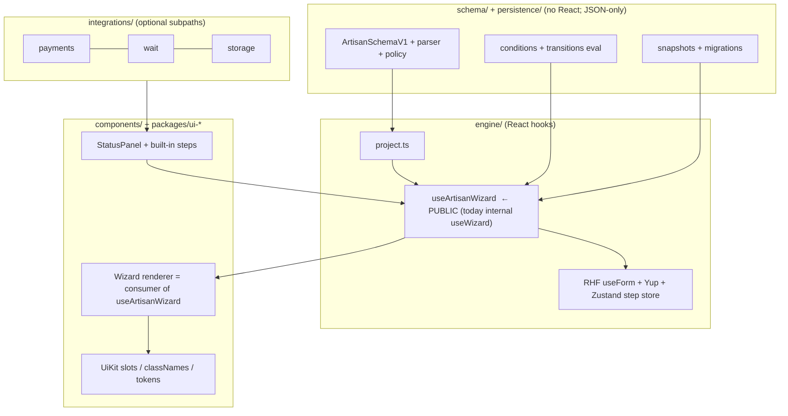
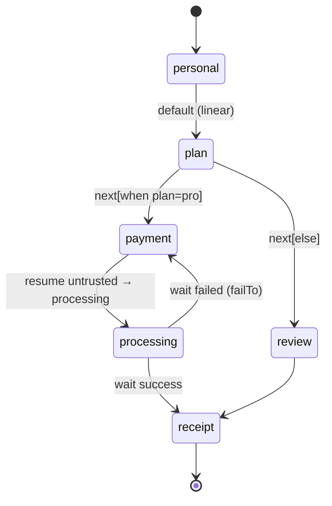

# ArtisanForm: evolution plan (headless · UI ready · workflow)

> Planning document (approved for writing; roadmap items still need your decisions in §9). Spanish mirror: [`docs/es/planning/artisanform-evolution.md`](../es/planning/artisanform-evolution.md). No source edits, no commits, no installs.
>
> **Audit basis.** Branch `fix/AF78-payment-resume-untrusted` (develop merged in, 3 commits ahead of `origin/develop`). Verified by reading code with three parallel read-only audits. Commands actually run: `bun test` → exit 0, 229 pass / 0 fail / 30 files; `bun run typecheck` → exit 0; `bun run lint` → exit 0 (3 warnings). NOT run: build, e2e, `lint:react`, `check:*`. Sizes below are measured from an existing `dist/`, not benchmarks. Competitor claims in §3 marked ✔ were verified by web search on 2026-11-10 (sources listed there); unmarked ones come from prior knowledge.

---

## 1. Executive summary

**Diagnosis.** ArtisanForm already has a good *contract* (serializable v1 schema, allowlist parser, normalizer, snapshots) and a good *wizard behavior* (`useWizard`), but they are not offered as layers. The engine still runs on the legacy 0.2.0 shape (`projectToRuntime` projects v1 back to it), navigation is index-based and strictly linear, there is no public headless API, and values are untyped (`Record<string, unknown>`). The pieces for "three adoption levels" exist; the seams between them are internal.

**Direction.**
1. **Stabilize** (cheap, unblocks everything): characterization tests for untested seams, fix known defects, remove the `useArtisanForm` name collision.
2. **Headless = promote `useWizard`**, not a new React-free engine. RHF is a React hook library; a React-free core would have zero second consumer today.
3. **Typed values + id-based navigation**, additive to v1 (no `schemaVersion: 2`).
4. **Workflow = optional `next` transitions on steps** + history stack, reusing existing `pending`/`WaitStrategy`/`PaymentStep`. No BPMN, no new engine.
5. **Snapshot migrations + pluggable storage** last; they depend on stable ids and transitions.

**Stay in one package.** Add *subpath entries* (`headless`, `schema`), not new packages.

---

## 2. Current state (audit)

Legend: ✅ stable · 🔧 implemented, needs work · ◐ partial · 📄 documented, not implemented · ✗ absent.

### 2.1 Contract / schema (`src/schema/**`)
| Item | Status | Evidence |
|---|---|---|
| v1 types: 28 native field types + `x-*`, 7 step types + `x-*` | ✅ | `contract/specs.ts` (`FIELD_KEYS`, `STEP_KEYS`, compile-time completeness via `specsAreComplete`) |
| Conditions (`eq…notEmpty`, `all/any/not`), depth cap 32 | ✅ | `contract/conditions.ts` `evaluateCondition` |
| Parser + allowlist `SchemaPolicy` (hooks, wait strategies, renderers, actions, providers; unsafe URLs; dup ids; dangling refs) | ✅ | `parser.ts` `parseArtisanSchema` |
| Normalizer + legacy adapter | ✅ | `normalize.ts`, `legacy/adapter.ts` |
| Conditions only read flat field names and only gate visibility | 🔧 | `contract/conditions.ts` |
| `optionsSource` only on combobox/multiselect | ◐ | `docs/schema-v1.md` §9 |
| `variant`, `layout:'horizontal'` not interpreted by default UI | ◐ | `FieldUIConfig.variant`; CSS has no `data-layout` rules |
| Conditions inside `array` rows; nested arrays | 📄 | schema-v1.md §14 |
| **Branching / transitions / `next` / `goTo`** | ✗ | no such key under `src/schema` |
| **Value-type inference** (`InferValues`); `defineForm` is identity | ✗ | `contract/define.ts`; `FormValues = Record<string, unknown>` (`engine/form/types.ts`) |

### 2.2 Engine (`src/engine/**`, `components/ArtisanForm/**`)
| Item | Status | Evidence |
|---|---|---|
| Single RHF `useForm` + one Yup object schema with `when()` conditions | ✅ | `form/useArtisanForm.ts`, `buildSchema.ts` |
| Zustand holds only `step, processStep, isFinalStep, submitState, submitError`, one store per instance | ✅ | `store/useArtisanStore.ts` |
| Visibility-based step skipping, per-step `trigger`, token-guarded async `beforeNext` | ✅ | `useWizard.ts` `advance` (L227-254), `engine/conditions.ts` |
| `useWizard` = all behavior; `Wizard.tsx` = markup only | ◐ | `useWizard.ts` (328 lines, `'use no memo'`). Internal, needs `FormProvider` + store provider, **not exported** |
| Engine consumes legacy shape; v1→legacy projection | 🔧 | `engine/project.ts` (only seam knowing both); `RuntimeProjection.key = JSON.stringify(schema)` resets form |
| Navigation index-based in public API (`step`, `onStepChange`, `goTo`, `ArtisanStepApi`) while snapshots are id-based | 🔧 | `ArtisanForm` props, `resolveStep` |
| `useArtisanStore` exposes internals (`processStep`, `isFinalStep`) as public | 🔧 | `src/index.ts` |
| **Public headless API** | 📄/✗ | useWizard doc comment, README "Pending" |
| Validation hard-wired to Yup (`FieldDefinition.rules` returns Yup schemas) | 🔧 | `fields/registry.tsx` |
| RHF/Yup/Zustand are hard peers even for schema-only consumers | 🔧 | `package.json` |
| **Name collision**: `docs/ui.md` promises a future public `useArtisanForm`; an internal `useArtisanForm` already exists returning `{methods, validators}` | 🔧 | `engine/form/useArtisanForm.ts` |

### 2.3 UI ready (`components/ui/**`, `packages/ui-*`, CSS)
| Item | Status | Evidence |
|---|---|---|
| 71 `af-*` slots + `classNames` + `unstyled` + tokens; kit merge precedence default<kit<props | ✅ | `ui/UiContext.ts`, `ui/kit.ts` |
| Replaceable: Stepper, Controls, StepHeader, FormError, FieldWrapper, 20 single-value inputs via `InputBridge` | ✅ | `ui/types.ts` `ArtisanComponents`, `InputBridge.tsx` |
| Kits: bootstrap, tailwind, mui, scss conformance-tested; shadcn = copy-paste item tested vs stubs only | ✅/◐ | `ui/__tests__/conformance.tsx`; `packages/ui-shadcn` |
| **Not replaceable via `components`**: `array`, `file/image`, `dynamicSelect`, `daterange`, content fields, `StatusPanel` (payment/pending/result screens), form shell, step order | 🔧 | `fields/registry.tsx` `renderField`; `steps/StatusPanel.tsx` |
| Stepper display-only (no visited/valid, no jump) | 🔧 | `Stepper.tsx` |
| Hard-coded `af-error` bypasses `cx`/`unstyled` in unknown-step fallback | 🔧 | `steps/registry.tsx` L448 |
| No dark-mode tokens, no `prefers-reduced-motion`, focus styles only on 3 classes | ✗ | `styles/artisanform.css` (928 lines, 12 `--artisan-*`; `-text` vs `-text-color` confusing) |
| `FieldDefinition` / custom step props untyped (casts like `step.wait as WaitStrategy`) | 🔧 | `steps/registry.tsx` |

### 2.4 Workflow-ish capabilities (`steps/`, `integrations/`)
| Item | Status | Evidence |
|---|---|---|
| `pending` step + `WaitStrategy` (polling/sse/websocket/callback), abort on unmount, retry, `failTo` | ✅ | `steps/registry.tsx` `PendingStep`, `integrations/wait` |
| Payment step: plugin choice, per-attempt idempotency key, redirect + embedded, retry/change method, redirect `resume` | ✅ | `steps/PaymentStep.tsx` |
| AF78: provider `resume` can no longer yield `succeeded` from URL (`fromReturnUrl`) | 🔧 | `payments/resume.ts`; per-plugin only. **Core `PaymentStep` trusts any plugin's `resume`; nothing requires a `pending` step after `processing`** |
| Payment `signal` never aborted (`new AbortController().signal` each call) | 🔧 | `PaymentStep.tsx` request builder |
| **Suspected bug (unverified at runtime):** `failTo` is a step id in v1 (`contract/steps.ts:55`) but projected to an index in the *full* step list (`project.ts:225`) and consumed by `goTo`, which indexes *visible* steps → misroute when an earlier step is hidden | 🔧 | to reproduce in Phase 0 |
| Generic async "action" step; cancel button on pending | ✗ | only async `beforeNext`, `onSubmit`, `optionsSource` |
| Storage: `StorageAdapter`, presigned/cloudinary/mock, abort on cancel/remove/unmount | ✅ | `integrations/storage` |

### 2.5 Persistence (`src/persistence/**`, `engine/draft.ts`)
| Item | Status | Evidence |
|---|---|---|
| `ArtisanSnapshotV1 {snapshotVersion:1, formId, formRevision?, currentStepId, values}`, JSON-only, secrets stripped | ✅ | `persistence/snapshots.ts`, `draft.ts` `withoutSecrets` |
| Conflict detection (form-id, revision, step-missing, unsupported-version, corrupt) + `onSnapshotConflict` backup/restore/discard; legacy draft upgrade | ✅ | `checkSnapshot`, `upgradeLegacyDraft` |
| localStorage only; helpers accept `Storage` but props don't expose it; write on every change, no debounce | 🔧 | `useWizard` save effect |
| IO helpers (`readRaw`, `writeSnapshot`, `restoreDraft`) not exported | ◐ | `persistence/index.ts` |
| **Migrations** | ✗/📄 | none; newer version = `unsupported` |
| Payment/wait progress not in snapshot | ◐ | `payments/resume.ts` separate |

### 2.6 Quality / distribution (measured)
- 30 unit/integration files (229 tests), 8 Playwright specs (22 tests, axe on Chromium), CI: lint, lint:react, typecheck, build, check:dist/package/pack, kits, build-storybook, bun test (Node 22/24), e2e compiler on/off, Firefox/WebKit, React 18/19 consumer tests from packed tarballs. Strong.
- **No dedicated unit tests** (coverage numbers NOT measured; may be exercised indirectly): `engine/store`, `engine/draft`, `engine/project.ts`, `engine/form/*`, `fields/registry.tsx` (18 KB), `steps/{registry,PaymentStep,StatusPanel}`, storage presigned/xhr/mock, kit packages. `kits.test.tsx` (477 B) and `conformance.test.tsx` (83 B) look thin.
- 3 lint warnings: unused params `useWizard.ts:66,72`; unused biome-ignore `StatusPanel.tsx:23`.
- Layer isolation: Biome rule + `schema/__tests__/isolation.test.ts` block third-party imports only; **nothing prevents `schema/` or `persistence/` importing `engine/` or `components/` by relative path**, and the regex misses `import('react')`/`import 'react'`.
- Package: ESM-only, single `index` entry that also imports CSS as a side effect, 4 optional payment subpaths. Measured (existing `dist/`, built Nov 10): `index.js` 154,142 B / **45,443 B gzip**; `style.css` 12,462 B / 2,919 B gzip; provider entries 0.8–1.4 KB gzip. No tree-shaking measurement exists.
- Drift: AGENTS.md omits `apps/docs` (Astro/Starlight, en/es); `docs/ui.md` "Pending" headless note collides with internal name; CHANGELOG shows `0.3.0-beta.0` as Unreleased while `docs/releasing.md` says it shipped; no git tags.

**Already exists, do not re-plan:** schema contract/parser/policy/normalizer, snapshot v1 + conflict handling, registries for fields/steps, UI kit merge system, wait strategies, payment plugins + redirect resume, storage adapters, per-step async `beforeNext`, id-based `resolveStep`, release/CI pipelines.

---

## 3. Competitive analysis (✔ = verified by web search on 2026-11-10; unmarked = prior knowledge)

| | Core idea | Strong at | Developer still does |
|---|---|---|---|
| **JSON Forms** | JSON Schema + UI Schema, renderer sets, AJV | ✔ React, Angular and Vue support; ✔ `Categorization` layout with a `stepper` variant (support per renderer set not confirmed) | Flow is a layout, no transitions/workflow; payments, waiting, drafts are all custom |
| **Uniforms** | ✔ Schema *bridges* (JSON Schema, Zod, GraphQL, SimpleSchema) + ✔ themes (AntD, Bootstrap, MUI, Semantic UI, plain HTML) + `AutoForm` | Bring-your-own schema; many UI themes | No wizard/workflow; persistence, async steps, payments custom |
| **SurveyJS** | JSON survey model + own runtime, pages, expressions, triggers | ✔ Conditional logic, many question types; ✔ Form Library is MIT, ✔ Survey Creator (builder) needs a paid per-developer license | Own runtime/UI model (less RHF-composable); payments/waiting/resume not confirmed either way |
| RHF / TanStack Form | State + validation primitives | Best-in-class headless | Everything above them; **complementary, we build on RHF** |

**Defensible differentiation (what ArtisanForm can own):**
1. **Wizard + payments + waiting + draft resume in one serializable contract** (not found as core features of the three; absence not proven).
2. **Security-first remote schemas**: allowlist policy parser; hooks/actions/renderers are ids resolved from a local registry, never code. (Implemented.)
3. **Same schema, three depths** over RHF: headless hook ↔ kit UI ↔ workflow, without a proprietary runtime (to build).
4. Versioned snapshots with conflict handling (implemented; migrations to build).

Sources: [JSON Forms docs mirror](https://www.mintlify.com/eclipsesource/jsonforms/concepts/ui-schema), [JSON Forms core README](https://cdn.jsdelivr.net/npm/@jsonforms/core@3.7.0/README.md), [Uniforms GitHub](https://www.github.com/vazco/uniforms), [SurveyJS licensing](https://surveyjs.io/Licenses). Most JSON Forms hits were third-party mirrors; confirm renderer-set stepper support on jsonforms.io before quoting it. Payments/waiting/draft-resume absence in the three competitors is **not** proven by these searches; phrase it as "not core features" externally.

**Do not copy:** a visual builder, expression language, many question types, multi-framework renderers.

---

## 4. Target architecture



Rules: schema describes, engine executes, renderer presents. **`Wizard.tsx` must become a plain consumer of the public hook** (dogfooding is the acceptance test for the headless API). Level 1/2/3 share one hook and one contract; level 3 is just more of the same schema (`next`, `pending`, `payment`).

### Workflow model (additive to v1)



---

## 5. API design (existing vs proposed)

### 5.1 Existing (do not re-implement)
```ts
// src/schema/contract/define.ts (EXISTING)
export const defineForm = (s: ArtisanSchemaV1): ArtisanSchemaV1 => s;
// src/engine/form/types.ts (EXISTING)
type FormValues = Record<string, unknown>;
// ArtisanForm props (EXISTING): step?: number; onStepChange?(i: number)
// ArtisanStepApi (EXISTING): next(), back(), values, setValue, errors, ...
```

### 5.2 Proposed: typed schema → typed values (additive)
```ts
// PROPOSED — const generic, stays backward compatible (default S = ArtisanSchemaV1)
export function defineForm<const S extends ArtisanSchemaV1>(s: S): S;
export type InferValues<S extends ArtisanSchemaV1> = /* map field.type → value type
  text|email|… → string; number|range|rating → number; checkbox|switch → boolean;
  multiselect → string[]; date → string; daterange → {start,end}; array → InferValues<item>[];
  x-* → unknown unless registry augments; content fields excluded */;
// ArtisanForm<S>: onSubmit?(values: InferValues<S>) — falls back to FormValues for plain ArtisanSchemaV1
```
Risk: type-level cost on large schemas; cap by measuring `tsc` time on the playground fixtures before shipping.

### 5.3 Proposed: headless hook (promote `useWizard`)
```ts
// PROPOSED — exported from 'artisanform' and 'artisanform/headless' (no CSS import)
export function useArtisanWizard<S extends ArtisanSchemaV1>(opts: {
  schema: S | unknown;                 // parsed with parseArtisanSchema + policy
  extensions?: ArtisanExtensions;
  fields?: FieldRegistry; stepTypes?: StepRegistry;
  initialValues?: Partial<InferValues<S>>;
  persistKey?: string; storage?: Storage;           // pluggable (Phase 5)
  onSubmit?(v: InferValues<S>): void | Promise<unknown>;
}): ArtisanWizard<S>;

interface ArtisanWizard<S> {
  form: UseFormReturn<InferValues<S>>;               // RHF escape hatch (documented, stable)
  steps: ReadonlyArray<{ id: string; title?: string; status: 'done'|'current'|'upcoming'; visited: boolean; valid?: boolean }>;
  current: { id: string; index: number; kind: string; fields: VisibleField[] };
  next(): Promise<boolean>;                          // validates, runs beforeNext, follows transitions
  back(): void;
  goToStep(id: string): Promise<boolean>;            // id-based; index API kept
  submit(): Promise<void>;
  submitState: 'idle'|'submitting'|'success'|'error'; submitError?: unknown;
  Provider: React.FC<{children: ReactNode}>;         // supplies RHF + store contexts for field bindings
  bindField(name: string): FieldBinding;             // = today's useArtisanField, now public
}
```
Decision: expose `form` (RHF) directly rather than wrapping every method — "don't reinvent RHF". Rename internal `useArtisanForm` → `useFormBinding` (internal) (decision 1).

### 5.4 Proposed: transitions (optional, additive)
```ts
// PROPOSED — on any StepV1; absent ⇒ today's linear behavior
interface StepBaseV1 { /* existing… */ next?: ReadonlyArray<{ when?: ConditionV1; to: string /* step id */ }>; }
```
```ts
// PROPOSED — per-step control (decision 4)
interface StepBaseV1 {
  loop?: { max: number };                 // how many times THIS step may be entered again via a back-edge; absent ⇒ no re-entry by transition
  revisit?: 'allow' | 'deny';             // after the step was confirmed (advance succeeded): can Back/goToStep return to it? default 'allow'
}
```
Example: `payment` → `revisit: 'deny'` once paid; `review` → `loop: { max: 3 }` for edit-and-re-review. `revisit:'deny'` steps are skipped by Back and rejected by `goToStep` (needs the completed-set in history). Both are my reading of decision 4; adjust if you meant something different.

Semantics: evaluate in order, first match wins, final entry without `when` is the default; no `next` ⇒ next visible step. Parser (compile-time, in `parseArtisanSchema`): unknown target (`unknown-step-reference`, existing code), unreachable steps (warning), **static cycle check**: a back-edge is rejected unless its target step declares `loop: { max: n }`. Runtime: **history stack** of visited step ids (Back pops history instead of `index-1`, which is wrong with branching); `maxVisits` guard as defense-in-depth.

### 5.5 Proposed: async resilience (reuse `wait`)
```ts
// PROPOSED — extend existing WaitStrategy usage, no new step type in first pass
wait: { strategy: 'polling', ..., retry?: { max: number; backoffMs: number }, timeoutMs?: number }
// pending step: optional Cancel control → failTo / back
```

### 5.6 Proposed: snapshot migrations
```ts
// PROPOSED — pure, in persistence/ (no React), registered by consumer
type SnapshotMigration = (s: ArtisanSnapshotV1) => ArtisanSnapshotV1;
migrations?: Record<string /* fromRevision */, SnapshotMigration>;   // chain until formRevision matches
```
`snapshotVersion` stays 1; add optional `history?: string[]` (transition history). No `schemaVersion: 2`: everything here is optional-field additions; only bump if a *required* shape changes.

---

## 6. Migration plan (no breakage)

| Change | Compat strategy |
|---|---|
| `defineForm` generic | default generic = current type; existing calls compile unchanged |
| `useArtisanWizard` | new export; `useWizard` internal stays until `Wizard.tsx` is migrated, then removed (internal) |
| Rename internal `useArtisanForm` | internal-only; no public break |
| `goToStep(id)` + `onStepChange(id)` | additive: keep `step`/`onStepChange(index)`; new `stepId`/`onStepIdChange`; deprecate index API in docs only |
| `next` transitions | optional field; parser warns but never errors on absent |
| `history` in snapshot | optional; old snapshots load, history derived from `currentStepId` |
| Payment core guard (apply `fromReturnUrl` for *every* plugin's `resume`) | **accepted** (decision 6): behavior change for custom plugins → CHANGELOG "Security: behavior change", like AF78 |
| `useArtisanStore` leak | kept as is, documented as internal (decision 7-B) |
| Schema-only subpath | `artisanform/schema` re-export; root keeps exporting everything |

Legacy 0.2.0 `FormSchema` continues through `adapter.ts`; it only gains typed values opt-out.

---

## 7. Roadmap

Effort: S ≈ days, M ≈ 1–2 weeks, L ≈ 3+ weeks (relative, one dev). Branching per AGENTS.md: one issue → one `feat|fix/AF<n>` branch from `develop`, small PRs.

### Phase 0 — Stabilize (S–M) · prerequisite for all
**Problem:** refactoring untested seams (`project.ts`, store, draft, registries) risks silent regressions; known defects exist.
Tasks (ordered):
1. 0.1 Characterization tests: `engine/project.ts`, `engine/store`, `engine/draft.ts`, `PaymentStep`, `steps/registry` (PendingStep), `fields/registry` rules.
2. 0.2 Reproduce `failTo` id-vs-index bug with a hidden earlier step; fix by resolving `failTo` against *visible* steps by id.
3. 0.3 Payment hardening in core: apply `fromReturnUrl` to any plugin `resume` result in `PaymentStep`; wire `request.signal` to unmount/leave; parser warning when a `payment` step is not followed (directly) by `wait`/`pending`; Stripe cancel → `failed` with message.
4. 0.4 Isolation test: forbid relative imports of `engine/`, `components/`, `integrations/` from `schema/` and `persistence/`, and dynamic/side-effect imports of banned packages.
5. 0.5 Clean 3 lint warnings; replace hard-coded `af-error` with `cx`.
6. 0.6 Doc drift: AGENTS.md (+es) add `apps/docs`; reconcile `docs/ui.md` headless note; decide CHANGELOG release heading/tag state.
**Files:** `engine/**`, `components/steps/*`, `integrations/payments/*`, `schema/parser.ts`, `schema/__tests__/isolation.test.ts`, docs.
**Acceptance:** `bun test` ≥ current pass count + new tests, 0 lint warnings, failTo regression test fails before / passes after, custom plugin returning `succeeded` from `resume` yields `processing` in test.
**Out of scope:** any new public API.

### Phase 1 — Headless API (M–L) · needs P0.1
**Problem:** adopters wanting their own UI must reimplement validation + navigation.
1. 1.1 Make `useWizard` independent of ambient providers: hook creates RHF + store itself and returns `Provider` (reuse `ArtisanFormInner` composition logic from `ArtisanForm.tsx`).
2. 1.2 Define `ArtisanWizard` return type (§5.3); export `useArtisanField` as `bindField`.
3. 1.3 Rewrite `Wizard.tsx`/`ArtisanForm.tsx` as consumers of the hook (dogfood). `'use no memo'` constraints preserved.
4. 1.4 New entry `artisanform/headless` (vite entry, no CSS import). Measure bundle with `check:dist`; record gzip delta vs 45,443 B baseline.
5. 1.5 Docs + playground scenario "Headless" (custom UI with plain inputs) + e2e.
**Risk:** React Compiler + `getValues()` in render; double RHF instances if both ArtisanForm and hook used → guard with a dev warning.
**Acceptance:** playground headless scenario renders a 3-step form with zero `af-*` classes and passes the same e2e flow as the kit version; existing `ArtisanForm` tests unchanged and green; consumer tests React 18/19 pass; `headless` entry has no CSS in `dist`.
**Out of scope:** React-free core, non-RHF validators, Vue/Svelte.

### Phase 2 — Types and id navigation (M) · needs P1.2
1. 2.1 `defineForm<const S>` + `InferValues` (§5.2) with type tests (`tsd`-style via `tsc` fixtures in `__tests__`; no new dependency if `expectTypeOf` from `bun:test` suffices).
2. 2.2 `goToStep(id)`, `stepId`/`onStepIdChange`; `ArtisanStepApi.goToStep`.
3. 2.3 Typed extension props: `StepDefinition<P>` generic to remove `as` casts.
**Acceptance:** compile-time tests pass; playground fixtures typecheck; `tsc` time on largest fixture not worse than +X% (set X after measuring baseline; not invented here).
**Out of scope:** inferring values from legacy 0.2.0 schemas.

### Phase 3 — Personalization (M) · independent after P1.3 (Stepper needs headless state)
1. 3.1 Slot `StatusPanel` (and `components.StatusPanel`) so payment/pending/result screens are themable.
2. 3.2 Uniform contract for multi-value inputs (`array`, `file`, `daterange`, `dynamicSelect`): extend `ArtisanInputProps` with generic `value/onChange` of their value type.
3. 3.3 Stepper navigation from `steps[].visited/valid` (optional `clickable` prop).
4. 3.4 CSS: dark tokens (`prefers-color-scheme` + `data-theme`), `prefers-reduced-motion`, `:focus-visible` on all interactive classes, interpret `layout:'horizontal'`; unify `-text`/`-text-color`.
5. 3.5 Run axe on new states; add kit conformance cases.
**Acceptance:** conformance suite extended and green for 4 kits; axe e2e clean on dark theme; reduced-motion verified by Playwright `emulateMedia`.
**Out of scope:** new kits, visual theme builder, RTL (track separately).

### Phase 4 — Declarative workflows (L) · needs P1, P2.2
1. 4.1 Contract: `next` on steps (§5.4) in `contract/steps.ts` + `specs.ts`; parser validation + cycle/reachability analysis; normalizer; `docs/schema-v1.md`.
2. 4.2 Engine: transition resolver (pure, in `schema/` next to conditions so it is testable without React) + history stack; Back via history; `visibleSteps` integrates.
3. 4.3 `project.ts` projects `next` (legacy engine has none → resolver lives outside legacy shape).
4. 4.4 Wait/pending: retry/backoff, timeout, Cancel control (§5.5).
5. 4.5 Snapshot `history?` (optional) + restore.
6. 4.6 Playground scenario (plan → payment → processing → receipt branching) + e2e incl. reload mid-flow.
**Risks:** infinite loops (static + runtime guard), Back semantics with skipped steps, payment redirect resume landing on a step reached by branch (history must be restorable).
**Acceptance:** parser rejects a back-edge to a step without `loop.max`; `revisit:'deny'` step is skipped by Back and rejected by `goToStep`, unknown target, unreachable step is warning; branching e2e passes in Chromium/Firefox/WebKit; reload on branched path resumes the right step; schemas without `next` produce identical behavior (existing integration tests untouched).
**Out of scope:** parallel branches, sub-workflows, timers/cron, compensation/sagas, visual designer, generic `action` step (decision 5).

### Phase 5 — Persistence evolution (M) · needs P4.5
1. 5.1 Public `persistence` IO (`readSnapshot/writeSnapshot/clearSnapshot` with `Storage`-like interface incl. async) and `storage` prop; debounce writes.
2. 5.2 Migration chain (§5.6) wired to `onSnapshotConflict` flow (`revision` conflict → try migrations before backup).
3. 5.3 Tests: migration chain, failure → backup, history restore.
**Acceptance:** old revision snapshot migrates and resumes; failing migration backs up (no data loss); sessionStorage/custom async store test.
**Out of scope:** server-side draft sync, multi-device conflict resolution.

**Ordering justification:** P0 before everything (no tests on seams); P1 before P4 (transitions + history belong in the shared hook, else logic gets duplicated in Wizard and headless); P2 can overlap P1 late; P3 is parallelizable; P5 last because migrations need stable ids/history.

---

## 8. Priority matrix

| Item | Impact | Effort | Risk | Depends on |
|---|---|---|---|---|
| P0 characterization tests + failTo fix + payment core guard | High | S–M | Low | – |
| P1 headless hook | **Very high** | M–L | Med (compiler/RHF) | P0.1 |
| P2 InferValues + id nav | High | M | Med (TS perf) | P1.2 |
| P3 slots/tokens/a11y | Med–High | M | Low | P1.3 |
| P4 transitions/workflow | High | L | **High** | P1, P2.2 |
| P5 migrations/storage | Med | M | Low–Med | P4.5 |
| Subpath `schema` entry | Low–Med | S | Low | P0.4 |

---

## 9. Decisions (resolved 2026-11-10)

| # | Decision |
|---|---|
| 1 | Public hook is **`useArtisanWizard`**; the internal `useArtisanForm` is renamed `useFormBinding`. |
| 2 | New entry **`artisanform/headless`** without CSS (A). |
| 3 | Transitions as **`next: [{ when?, to }]`**, first match wins (A). |
| 4 | Loops/re-entry are decided **per step**: `loop?: { max }` and `revisit?: 'allow' \| 'deny'` (§5.4). Cycles are not forbidden globally. |
| 5 | **No `action` step**; extend `wait` with retry/timeout/cancel (A). |
| 6 | Payment core guard **incorporated** as a behavior change with CHANGELOG notice. |
| 7 | `useArtisanStore` **stays as is**, documented as internal (B). |
| 8 | **Everything stays in `schemaVersion: 1`**; project is pre-public, so the contract is treated as internal and may still change without a version bump. No semver assigned. |
| 9 | `docs/planning/` and `docs/es/planning/` confirmed. |
| 10 | Competitor claims verified (§3). |

Still open (small): the exact semantics of `revisit`/`loop` in §5.4 are my interpretation of decision 4.

---

Issues and PRs (stacked in cascade): AF83 planning doc · AF84 characterization tests · AF85 `failTo` · AF86 payment guard · AF87 headless · AF88 typed values + id nav · AF89 personalization · AF90 transitions · AF91 wait retry/timeout/cancel · AF92 persistence.

---

## 10. What not to build

- A React-free independent core (RHF is React; no second consumer).
- A BPMN/generic automation engine, parallel branches, sub-workflows, timers.
- An expression language (conditions DSL is enough; add operators only on proven need).
- A visual builder; multi-framework renderers; many new field types.
- Replacing RHF/Yup/Zustand. Abstracting Yup behind a validator interface *now* (seam exists: `FieldDefinition.rules` + `project.ts`; do it when a second validator is requested).
- Splitting into core/react/workflow packages: no measured benefit; subpath entries give tree-shaking without version-lockstep cost (kits already cost 4-package lockstep).
- `schemaVersion: 2`, new kits, server draft sync, RTL (until a user asks).

---

## Closing answers

1. **Real value today:** declarative wizard over RHF with a safe remote-schema contract (allowlist parser), plus payments/wait/storage/draft-resume as first-class steps, kit-based UI.
2. **Limits slowing evolution:** engine runs on the legacy shape via `project.ts`; index-based linear navigation; behavior locked in an unexported `useWizard`; untyped values; untested seams (project/store/draft/registries); hard-wired Yup; fixed Wizard shell and un-slottable status/array/file UI.
3. **Most defensible differentiation:** one serializable, security-allowlisted contract that covers form + payment + waiting + resume, usable headless or with kits, on top of RHF.
4. **Build first:** Phase 0 (tests, `failTo`, payment guard), then the headless hook (Phase 1).
5. **Don't build:** see §10 (core engine rewrite, BPMN, builder, expression DSL, package split).
6. **Without reinventing:** the headless hook returns the RHF `form` as-is; Zustand stays for step state; Yup stays behind `rules`; transitions reuse `ConditionV1` and existing `pending`/`payment`.
7. **Shortest path:** P0 → P1 (promote `useWizard`, dogfood in `Wizard.tsx`) → P2.2 (id nav) → P4.1–4.2 (`next` + history) — workflows stay opt-in because schemas without `next` behave exactly as today.

---
